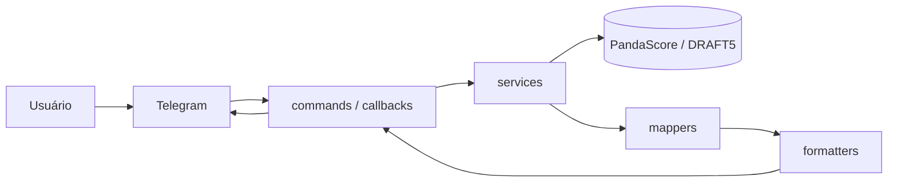

# 🐆 Bot da FURIA CS2 no Telegram

Bot de Telegram em **Node.js + TypeScript** com os próximos jogos, os resultados, a lineup e as notícias do time de CS2 da FURIA.

> Começou como desafio técnico para a FURIA Esports e evoluiu como projeto de portfólio, com foco em código limpo, tipagem estrita e arquitetura em camadas.

🔗 **Teste agora:** [@O_mais_novo_furioso_bot](https://t.me/O_mais_novo_furioso_bot)

## 📌 Funcionalidades

| Comando | O que faz |
|---|---|
| `/start` | Menu com botões interativos |
| `/proximosjogos` | Próximos 5 jogos: adversário, campeonato, fase, MD e horário de Brasília |
| `/ultimosjogos` | Últimos 5 jogos com placar e resultado (✅ ❌ ⏸️), incluindo W.O. |
| `/lineup` | Jogadores ativos com bandeira e nome completo |
| `/noticias` | 5 notícias recentes do DRAFT5, com imagem, resumo e link |

- Cada comando também funciona pelo botão do menu.
- Uma mensagem de "🔍 Buscando..." é **editada** com o resultado, sem poluir o chat.
- Se der erro, o usuário recebe uma mensagem amigável e o bot continua no ar.

## 🛠️ Stack

- **Node.js + TypeScript** (`strict`, CommonJS, ES2020)
- **[grammY](https://grammy.dev)**: framework do Telegram (long polling)
- **axios**: chamadas HTTP com timeout
- **dotenv**: variáveis de ambiente
- **[PandaScore API](https://pandascore.co)**: jogos e lineup
- **DRAFT5** (`api.draft5.gg`, não oficial): notícias

## 🏗️ Arquitetura



```
src/
├── index.ts                # Liga o bot (polling) e trata os sinais de desligamento
├── config/
│   ├── env.ts              # Único arquivo que lê o process.env; valida as variáveis
│   └── team.ts             # IDs e dados do time
└── bot/
    ├── bot.ts              # Monta o bot: composers, ordem e bot.catch
    ├── callbackHandlers.ts # Botões do menu
    ├── commands/           # Um Composer + uma função send*(ctx) por comando
    ├── services/           # Acesso às APIs (pandascore/, draft5/) + tipos das respostas
    ├── mappers/            # Resposta da API → formato do bot (MatchCard, PlayerCard)
    ├── formatters/         # Formato do bot → texto HTML (funções puras)
    └── utils/              # editOrSend, datas, bandeiras, escapeHtml
```

## 💡 Decisões de design

- **Montar ≠ ligar:** o `bot.ts` monta o bot e o `index.ts` liga. Trocar polling por webhook muda só o `index.ts`.
- **Um Composer por comando:** cada comando é independente e testável. O handler de "comando desconhecido" fica sempre por último.
- **`send*(ctx)` reutilizável:** o mesmo código atende o comando digitado e o botão.
- **Service → mapper → formatter:**
  - o *service* só busca dados;
  - o *mapper* traduz a API para o formato do bot, sempre do ponto de vista da FURIA;
  - o *formatter* é **puro**: recebe dados prontos e devolve texto, sem rede nem config.

  Para trocar de fonte de dados, basta mudar o service e o mapper.
- **Placar e resultado pelo `team_id`**, nunca pela posição no array: a FURIA pode vir em `[0]` ou em `[1]`.
- **Union types** (`status`, `result`) impedem valores inválidos em tempo de compilação. Nenhum `any`.
- **HTML + `escapeHtml`** em todo dado externo, porque o Markdown quebra com `_`, `*` e `[` em nomes e títulos.
- **`sort` explícito e `scheduled_at`** (horário agendado), sem depender da ordem padrão da API.
- **Duas redes de erro:** o `bot.catch` loga sem derrubar o bot, e o `unhandledRejection` pega o que escapar.
- **Cache em memória** (lineup 1h, notícias 15 min) para evitar o erro 429 (limite de requisições).

## 🧪 Rodando localmente

**Requisitos:** Node 20+, um token do [@BotFather](https://t.me/BotFather) e uma chave da [PandaScore](https://app.pandascore.co).

```bash
git clone https://github.com/ygor-ccarvalho/telegram-bot-furia.git
cd telegram-bot-furia
npm ci
cp .env.example .env   # preencha os valores
npm run dev
```

| Script | O que faz |
|---|---|
| `npm run build` | Compila `src/` → `dist/` |
| `npm start` | Roda `dist/index.js` |
| `npm run dev` | Build + start |

## ⚠️ Limitações conhecidas

- A API do DRAFT5 não é oficial e pode mudar sem aviso.
- O cache fica em memória: é perdido quando o bot reinicia e não é compartilhado entre instâncias.
- Ainda não há testes automatizados.

## 🗺️ Próximos passos

- [ ] Deploy 24/7 (Waifly)
- [ ] Testes dos mappers e formatters (funções puras)
- [ ] Cache e cadastro de usuários no MongoDB Atlas (TTL index)
- [ ] Notificações de jogos e notícias
